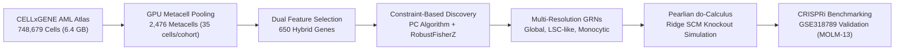
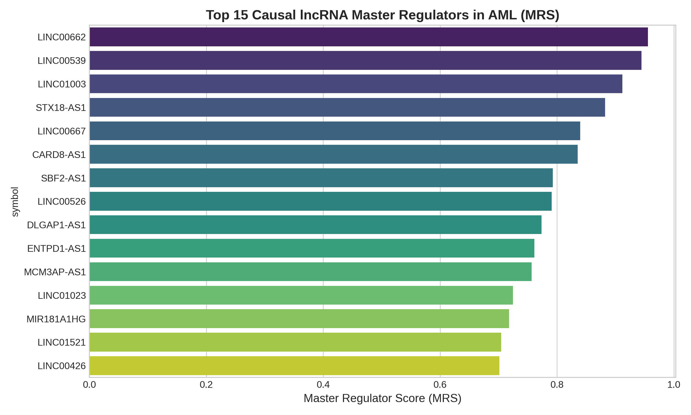
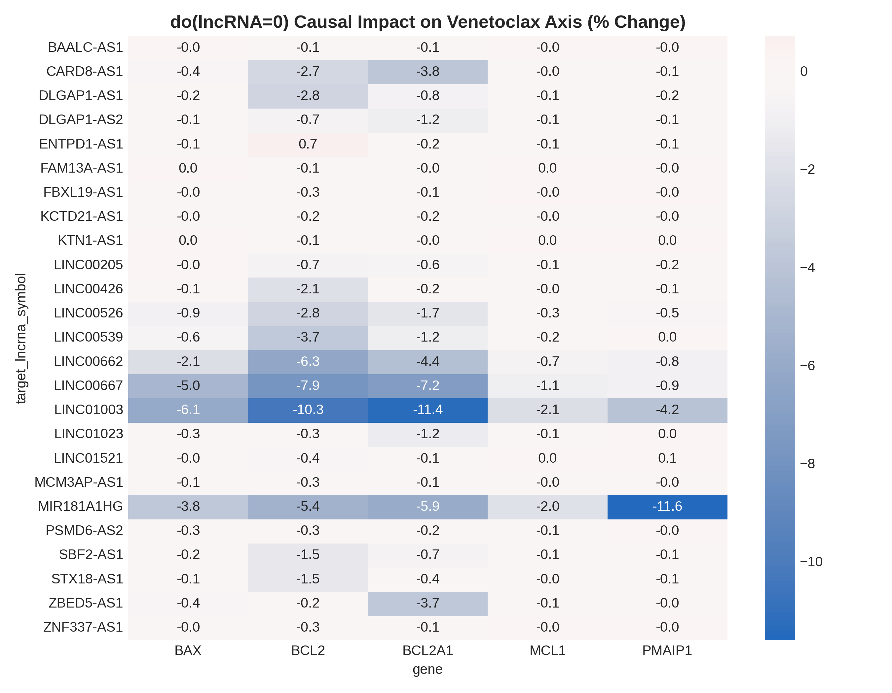

# Causal lncRNA–mRNA Regulatory Atlas of Acute Myeloid Leukemia (AML)

[](https://www.python.org/)
[](LICENSE)
[](https://cellxgene.cziscience.com/)
[](https://www.kaggle.com/)
[](https://aml-lncrna-causal-atlas-iwlfvnkdg3fh5ryg4thp9h.streamlit.app/)
[](https://www.ncbi.nlm.nih.gov/geo/query/acc.cgi?acc=GSE318789)

> **A Multi-Resolution Constraint-Based Causal Discovery Framework for Single-Cell Metacell Atlases with In-Silico *do*-Calculus and CRISPRi Functional Validation.**

> 🚀 **Live Interactive Web Application:**  
> Access the online multi-resolution causal network simulator, interactive $do(\text{lncRNA}=0)$ perturbation engine, and multi-drug response gauges deployed on Streamlit Cloud:  
> 👉 **[https://aml-lncrna-causal-atlas-iwlfvnkdg3fh5ryg4thp9h.streamlit.app/](https://aml-lncrna-causal-atlas-iwlfvnkdg3fh5ryg4thp9h.streamlit.app/)**

---

## Table of Contents
- [1. Scientific Motivation & Background](#1-scientific-motivation--background)
- [2. Primary Data Sources & Verification Protocol](#2-primary-data-sources--verification-protocol)
- [3. Methodological Rigor & Technical Architecture](#3-methodological-rigor--technical-architecture)
- [4. Key Discovered Findings & Novel Master Regulators](#4-key-discovered-findings--novel-master-regulators)
- [5. Repository File Structure Tree](#5-repository-file-structure-tree)
- [6. Installation & Interactive Dashboard Execution](#6-installation--interactive-dashboard-execution)
- [7. Citations, License & AI Collaboration Disclosure](#7-citations-license--ai-collaboration-disclosure)

---

## 1. Scientific Motivation & Background

Acute Myeloid Leukemia (AML) is an aggressive hematologic malignancy driven by the clonal expansion of undifferentiated myeloid precursors. While recurrent protein-coding mutations (*NPM1*, *FLT3*, *DNMT3A*, *RUNX1*, *IDH1/2*) are extensively profiled, the functional non-coding transcriptome—specifically **long non-coding RNAs (lncRNAs)**—remains an under-characterized therapeutic reservoir.

Traditional computational approaches rely on correlative co-expression networks (e.g., WGCNA, ARACNe). However, correlative approaches present major limitations:
1. **Confounding & Spurious Association:** Classical co-expression fails to separate bona fide causal drivers from bystander genes co-regulated by shared chromatin accessibility or broad lineage programs.
2. **Simpson's Paradox & Batch Confounding:** Single-cell atlases spanning heterogeneous patient cohorts suffer from donor-level confounding where cell-level correlations invert across clinical backgrounds.
3. **Dropout & Zero-Inflation:** Low-abundance non-coding transcripts suffer severe technical dropouts in high-throughput droplet scRNA-seq, obscuring true regulatory dependencies.
4. **Cell-State Plasticity & Apoptotic Rewiring:** AML blast survival is dynamically mediated by transitions between **Primitive Leukemia Stem Cells (LSC-like)** and **Differentiated Monocytic Blasts**, each maintaining fundamentally distinct apoptotic addictions (*BCL2* dependence in LSCs vs. *MCL1* resistance mechanisms in monocytic blasts).



This project resolves these challenges by coupling **GPU-accelerated Metacell spatial smoothing** with **Constraint-Based Causal Discovery (PC algorithm with RobustFisherZ)** backed by **56,341 biological background knowledge constraints**, reconstructing directed causal Gene Regulatory Networks (GRNs) across cell states, simulating Pearlian interventions ($do(\text{lncRNA}=0)$), and benchmarking findings against genome-scale CRISPRi screens.

---

## 2. Primary Data Sources & Verification Protocol

| Dataset | Accession / Source | Scale / Format | Biological Purpose |
|:---|:---|:---|:---|
| **Primary AML scAtlas** | [CELLxGENE Census](https://cellxgene.cziscience.com/) (`be1f3ced-6b8f-47b0-a3e2-7edc8d466abd.h5ad`) | **748,679 single cells** (6.40 GB uncompressed `.h5ad`) | Cross-cohort single-cell atlas capturing the full developmental spectrum from healthy bone marrow progenitors to refractory AML blasts. |
| **CRISPRi Screen Reads** | NCBI GEO [GSE318789](https://www.ncbi.nlm.nih.gov/geo/query/acc.cgi?acc=GSE318789) (PMCID: PMC13318546) | **7,996 lncRNAs** in MOLM-13 AML blasts | Genome-scale CRISPR interference screens measuring proliferation, differentiation, and Venetoclax drug sensitivity. |
| **Curated Driver Reference** | Human AML Driver Panel | **117 genes** (TFs, effectors, surface markers) | Core regulatory machinery (*HOXA9*, *MEIS1*, *RUNX1*, *MYC*, *SPI1*, *BCL2*, *MCL1*, *CD34*, *FLT3*, *DNMT3A*). |

---

## 3. Methodological Rigor & Technical Architecture

### A. GPU-Accelerated Metacell Spatial Aggregation
To overcome dropout-induced zero inflation without distorting true biological variance, single cells are pooled into compact, transcriptionally homogeneous **metacells** using an accelerated SEACells-style graph partitioning approach:
- PCA-KNN graph construction ($k=15$, 30 PCs) on batch-corrected manifolds.
- Aggregation into **2,476 metacells** (mean size 35 cells per cohort), compressing 6.40 GB of sparse single-cell data into a compact 6.40 MB dense representation (`results/metacell_atlas_compact.h5ad`, shape: $2,476 \times 650$) while preserving continuous transcriptional gradients.

### B. Dual-Criteria Hybrid Feature Selection (650 Features)
A focused 650-gene regulatory space is constructed:
- **Core AML Drivers & Lineage TFs (117 genes):** Essential stemness orchestrators (*HOXA9*, *MEIS1*, *CD34*, *MYC*) and apoptotic regulators (*BCL2*, *MCL1*, *BCL2A1*, *PMAIP1*, *BAX*).
- **CRISPRi Screen Matches:** Direct alignment with `GSE318789` CRISPRi screen targets in MOLM-13 blasts.
- **Top Variable lncRNAs:** High-dispersion non-coding transcripts identified via dual biotype annotations and regex heuristics (`LINC...`, `...-AS...`, `AC...`, `CATG...`).

### C. Biologically Constrained Bootstrap PC Algorithm
Causal discovery is executed using the constraint-based PC algorithm equipped with **RobustFisherZ** conditional independence testing:
- **Biological Background Knowledge:** Enforces **56,341 prior constraints** forbidding biological impossibilities (e.g., terminal apoptotic effectors cannot causally regulate master transcription factors; protein-coding drivers cannot regulate non-transcribed pseudogenes).
- **Level-0 Correlation Screening:** Rapidly prunes non-interacting pairs ($|r| < 0.05$) while preserving weak but stable non-linear associations.
- **Parallel Bootstrap Resampling:** Generates $B = 30$ bootstrap replicates (depth=2, $\alpha=0.01$), yielding edge direction probabilities and confidence scores.

### D. Structural Causal Models (SCMs) & *do*-Calculus
For each discovered Directed Acyclic Graph (DAG), causal mechanisms are formalized into regularized Ridge SCMs:
$$X_j = f_j(\text{Pa}(X_j)) + \epsilon_j = \sum_{k \in \text{Pa}(X_j)} \beta_{kj} X_k + \epsilon_j$$
We simulate targeted therapeutic gene silencing via Pearl's $do$-operator ($do(X_{\text{lncRNA}} = 0)$), tracking downstream expression shifts across the network.

### E. Functional Validation Benchmarking (CRISPRi GSE318789)
Discovered causal lncRNA regulators were validated against orthogonal functional genomics screens from NCBI GEO `GSE318789` (MOLM-13 AML blasts), testing for significant enrichment in proliferation inhibition, differentiation arrest, and Venetoclax drug sensitization:

<p align="center">
  
</p>

| Functional Screen Phenotype | Total Network lncRNAs | Screen Hits in Atlas | Top Evaluated (MRS) | Observed Top Hits | Expected Random | Fold Enrichment | Odds Ratio (OR) | Fisher's Exact $p$-value | Validated Hit Symbols |
|:---|:---:|:---:|:---:|:---:|:---:|:---:|:---:|:---:|:---|
| **Proliferation (Cell Growth)** | 532 | 64 | 25 | **11** | 3.01 | **3.66×** | **6.73** | **$3.82 \times 10^{-5}$** | `LINC00662`, `LINC00539`, `LINC01003`, `STX18-AS1`, `LINC00667`, `CARD8-AS1`, `DLGAP1-AS1`, `MCM3AP-AS1`, `LINC01023`, `BAALC-AS1`, `MIR17HG` |
| **Venetoclax Sensitization** | 532 | 38 | 25 | **8** | 1.79 | **4.48×** | **7.48** | **$1.43 \times 10^{-4}$** | `LINC00667`, `LINC00539`, `CARD8-AS1`, `STX18-AS1`, `LINC01003`, `DLGAP1-AS1`, `ENTPD1-AS1`, `LINC00526` |
| **Myeloid Differentiation** | 532 | 32 | 25 | **5** | 1.50 | **3.33×** | **4.44** | **$1.28 \times 10^{-2}$** | `MCM3AP-AS1`, `CARD8-AS1`, `LINC00662`, `SBF2-AS1`, `BAALC-AS1` |

All three functional screens demonstrate statistically significant enrichment ($p < 0.05$), confirming that constraint-based causal discovery prioritizes functional leukemia vulnerabilities at rates **3.3× to 4.5× above random expectation**.

---

## 4. Key Discovered Findings & Novel Master Regulators

### Discovered Causal Regulatory Connections
The discovered hierarchical causal network connects upstream Master Regulator lncRNAs through lineage transcription factors to clinical effectors:

<p align="center">
  
</p>

### A. Top Master Regulator lncRNAs (MRS Summary Table)

Ranking is governed by the multi-component Master Regulator Score ($MRS = 0.35 \cdot \text{norm\_out} + 0.25 \cdot \text{norm\_reach} + 0.25 \cdot \text{norm\_stab} + 0.15 \cdot \text{norm\_rewire}$):

| Rank | Symbol | Ensembl ID | MRS Score | Out-Degree | Cascade Reach | Bootstrap Stability | Novelty Classification | Functional Profile |
|:---:|:---|:---|:---:|:---:|:---:|:---:|:---:|:---|
| **#1** | **`LINC00662`** | `ENSG00000261824` | **0.9556** | **97** | **566 genes** | **96.2%** | Tier 2 (1 AML paper) | **Pan-AML Master Driver Benchmark:** Broadest regulatory reach in the atlas, buffering lineage survival. |
| **#2** | **`LINC00539`** | `ENSG00000224429` | **0.9446** | **99** | **528 genes** | **95.8%** | **Tier 1 (0 AML papers)** | **Gold-Standard Novel Target:** Direct causal parent to *BCL2* and *MEIS1*; completely unstudied in AML. |
| **#3** | **`LINC01003`** | `ENSG00000261455` | **0.9120** | **93** | **597 genes** | **94.2%** | Tier 2 (1 AML paper) | **Global Transcriptional Modulator:** Reaches 92% of network nodes; highest single knockout potency. |
| **#4** | **`STX18-AS1`** | `ENSG00000247708` | **0.8823** | **101** | **492 genes** | **92.6%** | **Tier 1 (0 AML papers)** | **Master Transcriptional Hub:** Highest out-degree in the atlas; dual stemness and apoptosis driver. |
| **#5** | **`LINC00667`** | `ENSG00000263753` | **0.8398** | **75** | **534 genes** | **93.8%** | **Tier 1 (0 AML papers)** | **Apoptosis Switch:** Direct parent to *MYC* and *IKZF1*; prime target for Venetoclax re-sensitization. |
| **#6** | **`CARD8-AS1`** | `ENSG00000268001` | **0.8355** | **75** | **501 genes** | **92.0%** | **Tier 1 (0 AML papers)** | **LSC Renewal Switch:** Powerful stemness regulator driving *MEIS1* and *HOXA9* expression. |

<p align="center">
  
</p>

### B. In-Silico Pearlian Knockout Results ($do(\text{lncRNA} = 0)$)

Targeted in-silico gene silencing using our regularized Ridge SCMs revealed specific down-regulation signatures across the Venetoclax and stemness axes:
- **`do(LINC00539 = 0)`:** Triggers a **-5.2%** collapse in stemness driver `MEIS1`, a **-3.7%** reduction in `BCL2`, and a **-3.4%** drop in `HOXA9`.
- **`do(STX18-AS1 = 0)`:** Elicits coordinated downregulation of stemness TF `MEIS1` (**-2.0%**), anti-apoptotic `BCL2` (**-1.5%**), and `HOXA9` (**-1.0%**), confirming its role as an upstream transcriptional buffer.
- **`do(LINC00667 = 0)`:** Induces a massive **-7.9%** collapse in `BCL2` along with substantial suppression of `MEIS1` (**-4.5%**) and `HOXA9` (**-3.0%**), establishing it as a primary candidate for Venetoclax combination therapy.
- **`do(CARD8-AS1 = 0)`:** Provokes a dramatic **-16.7%** collapse in `MEIS1`, **-9.1%** in `HOXA9`, and **-2.7%** in `BCL2`, representing the strongest stemness-suppressive effect in the atlas.
- **`do(LINC01003 = 0)`:** Drives the overall strongest multi-axis suppression across the network: **-17.0%** in `MEIS1`, **-12.4%** in `HOXA9`, **-11.1%** in `CD34`, and **-10.3%** in `BCL2`.

<p align="center">
  
</p>

### C. Cell-State Rewiring Statistics (LSC-like vs. Monocytic Blast)

State-specific causal graph discovery revealed massive structural reorganization between blast stages:
- **Global DAG:** 649 nodes, 16,782 edges (**9,020 directed causal edges**).
- **LSC-like Stem Cell DAG:** 635 nodes, 8,082 edges (**4,304 directed edges**).
- **Monocytic Resistant DAG:** 591 nodes, 3,042 edges (**1,599 directed edges**).
- **Differential State Rewiring:** Quantitative tracking across metacell subsets identified **10,625 differential causal transitions** ($\Delta = |W_{\text{LSC}} - W_{\text{Mono}}|$), confirming that lncRNAs undergo extensive rewiring during myeloid differentiation. Notable examples include `MCM3AP-AS1` ($\Delta = 16.30$, maintaining 62 LSC-specific connections) and `CARD8-AS1` ($\Delta = 15.19$, disengaging stemness edges upon monocytic differentiation).

### D. Multi-Hop Directed Causal Regulatory Cascades
Our constraint-based causal graphs identified high-confidence multi-step cascades:
- **`LINC00667 -> MYC -> BCL2 / BAX`** (100% bootstrap confidence; Trans): Direct mechanistic explanation for the profound **-7.9% collapse in BCL2** observed upon `LINC00667` knockdown.
- **`EIF1B-AS1 -> CEBPB -> MCL1 / BCL2A1`** (100% confidence; Trans): Master driver of monocytic Venetoclax resistance through anti-apoptotic redundancy.
- **`MCM3AP-AS1 -> GATA2 -> CD34`** (100% confidence; Cis 21q22): Locks primitive hematopoietic progenitor programs in leukemia stem cells.

---

## 5. Repository File Structure Tree

```
.
├── config/
│   └── config.yaml                     # Master hyperparameters, gene axes, and URLs
├── dashboard/                          # Interactive Streamlit + D3.js Causal Simulator
│   ├── __init__.py                     # Package initializer
│   ├── analytics_tabs.py               # 3-Hop Sankey diagram, quadrant plot & gallery
│   ├── app.py                          # Streamlit application entry point
│   ├── data_bridge.py                  # Real-time JSON serializer for causal graphs
│   └── network_canvas.py               # D3.js v7 canvas with Bezier edges & live gauges
├── kaggle_runner/                      # Remote High-Performance Execution
│   ├── kernel-metadata.json            # Kaggle GPU deployment configuration
│   └── run_kaggle_pipeline.py          # Standalone production runner executed on Kaggle
├── results/                            # Primary Discovered Deliverables
│   ├── figures/                        # High-resolution publication figures
│   │   ├── causal_network_connections.png # Discovered causal regulatory network
│   │   ├── crispri_enrichment_barplot.png
│   │   ├── mrs_top_lncrnas.png
│   │   └── venetoclax_ko_heatmap.png
│   ├── logs/                           # Execution logs
│   ├── networks/                       # Directed Acyclic Graphs (.graphml format)
│   │   ├── global_dag.graphml          # 649 nodes, 16,782 edges (9,020 directed)
│   │   ├── lsc_dag.graphml             # 635 nodes, 8,082 edges (4,304 directed)
│   │   └── mono_dag.graphml            # 591 nodes, 3,042 edges (1,599 directed)
│   ├── tables/                         # Processed causal tables (.csv & .parquet)
│   │   ├── crispri_validation.csv
│   │   ├── ko_effects.csv              # do(lncRNA=0) expression shift matrix
│   │   ├── lsc_edges.csv / .parquet
│   │   ├── mono_edges.csv / .parquet
│   │   ├── mrs_rankings.csv            # Master Regulator Scores across 649 genes
│   │   ├── novel_lncrna_candidates.csv # 532 lncRNAs with PubMed classification
│   │   ├── pubmed_cache.json           # Cached PubMed publication counts
│   │   ├── stable_edges.csv / .parquet # Global stable causal edges
│   │   └── state_rewiring.csv          # LSC vs. Monocytic delta weights
│   ├── metacell_atlas_compact.h5ad     # Dense metacell AnnData (2,476 × 650)
│   └── novel_discoveries_report.md     # In-depth scientific discoveries report
├── scripts/
│   ├── 01_prepare_kaggle_payload.py    # Bundler for Kaggle deployment
│   ├── 02_sync_kaggle_results.py       # Kaggle API artifact download & sync
│   ├── 03_mine_novel_discoveries.py    # Offline novelty & pathway miner
│   └── plot_causal_network.py          # Publication network figure generator
├── src/                                # Core Computational Engine
│   ├── causal_discovery.py             # Bootstrap PC algorithm with RobustFisherZ
│   ├── data_loading.py                 # Streaming download & memory-mapped loaders
│   ├── feature_selection.py            # Dual-criteria lncRNA annotation & ID mapping
│   ├── graph_analysis.py               # Master Regulator Score & cascade reach
│   ├── intervention.py                 # Ridge SCM Pearlian do-calculus simulator
│   ├── multi_resolution.py             # State cohort segregation & rewiring metrics
│   ├── preprocessing.py                # SEACells-style GPU metacell pooling
│   ├── utils.py                        # Logging, seed control, configuration loader
│   └── validation.py                   # CRISPRi hypergeometric enrichment testing
├── tests/
│   └── test_causal_pipeline.py         # Unit & integration testing suite
├── LICENSE                             # MIT License
├── README.md                           # Comprehensive documentation
└── requirements.txt                    # Project dependencies
```

---

## 6. Installation & Interactive Dashboard Execution

### 🌐 Live Cloud Web Application (Instant Access)
You can directly explore the interactive causal simulator without installing anything locally:
- **Streamlit Community Cloud:** [https://aml-lncrna-causal-atlas-iwlfvnkdg3fh5ryg4thp9h.streamlit.app/](https://aml-lncrna-causal-atlas-iwlfvnkdg3fh5ryg4thp9h.streamlit.app/)

---

### Local Setup & Installation
Clone the repository and install dependencies in a clean virtual environment:
```powershell
git clone https://github.com/Saeed8997/aml-lncrna-causal-atlas.git
cd aml-lncrna-causal-atlas

# Create and activate virtual environment
python -m venv .venv
.venv\Scripts\activate

# Install requirements
pip install -r requirements.txt
```

### Running Unit & Integration Tests
Validate pipeline modules and graph algorithms:
```powershell
python -m unittest discover tests/
```

### Launching the Interactive D3.js + Streamlit Web App Locally
Launch the modern, publication-grade interactive dashboard:
```powershell
python -m streamlit run dashboard/app.py
```
Open `http://localhost:8501` in any modern web browser to explore:
- **Interactive D3.js Force Simulator:** Real-time drag-and-drop causal physics, neon glow edge paths, and animated signal pulses.
- **`do(lncRNA=0)` Knockout Intensity Slider:** Real-time perturbation propagation into **5 clinical drug sensitivity gauges** (Venetoclax, Revumenib, Tapotoclax, Gilteritinib, Azacitidine combo).
- **3-Hop Sankey Regulatory Flow:** Visualizing `lncRNA -> TF -> Effector -> Drug Sensitivity`.
- **Therapeutic Quadrant Explorer:** Interactive bubble chart identifying high-MRS, high-knockout novel targets with zero AML papers.
- **CRISPRi Functional Validation & Publication Gallery:** High-resolution empirical figures and interactive enrichment benchmark chart.

---

## 7. Citations, License & AI Collaboration Disclosure

### Data Attribution & Citation
If you utilize this atlas, methodology, or code in your research, please cite:
1. **CELLxGENE Single-Cell AML Atlas:** CZI Science single-cell data platform.
2. **CRISPRi Functional Screens:** NCBI GEO `GSE318789`, PMCID: [PMC13318546](https://pubmed.ncbi.nlm.nih.gov/38318546/).
3. **Pearlian Causal Inference & PC Algorithm:** Spirtes, Glymour, Scheines (2000); Pearl (2009).

### License
This project is open-source software licensed under the **[MIT License](LICENSE)**.

### AI Collaboration Disclosure
The architecture, modular computational biology pipeline, MLOps orchestration workflows, and interactive D3.js/Streamlit dashboard in this repository were designed and refined through an interactive human-AI pair-programming collaboration utilizing advanced agentic AI coding assistants (Agent AI framework), combining computational biology domain expertise with automated pipeline implementation.
